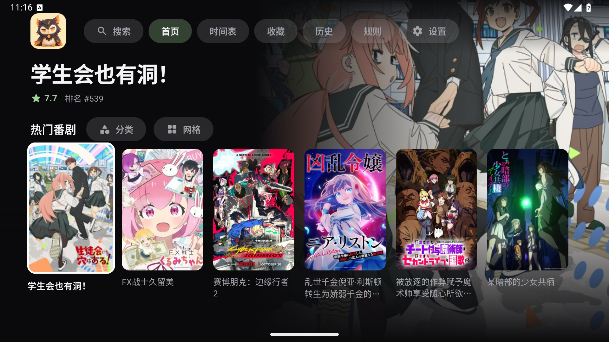
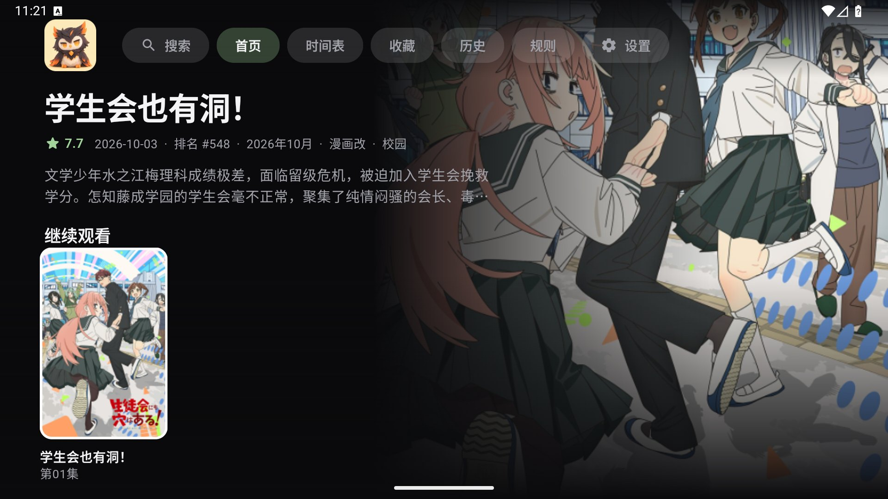
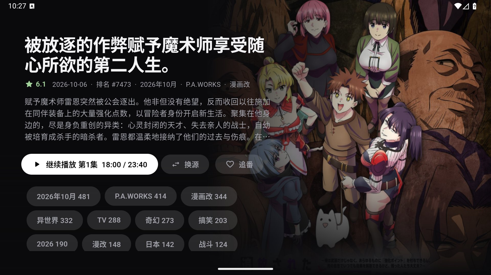
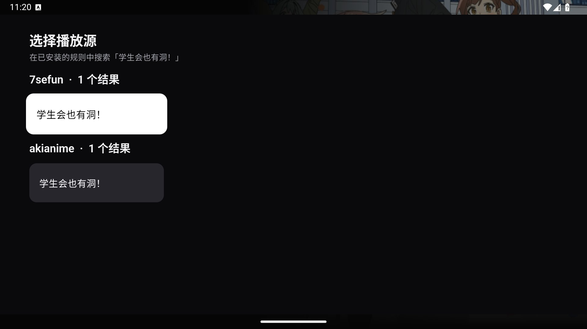
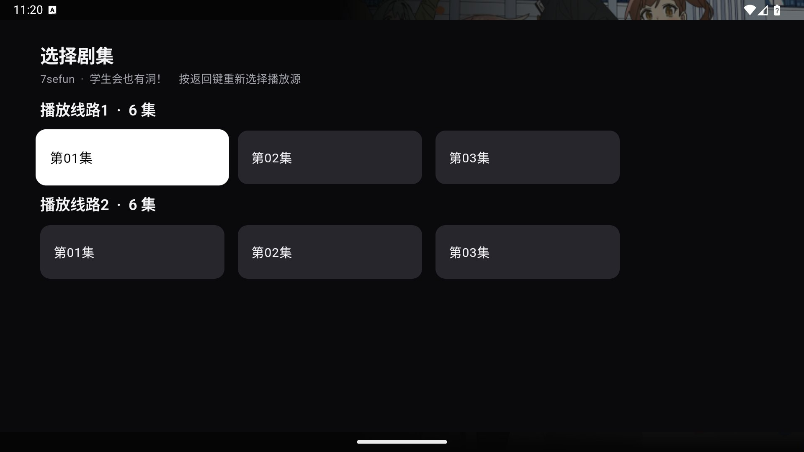
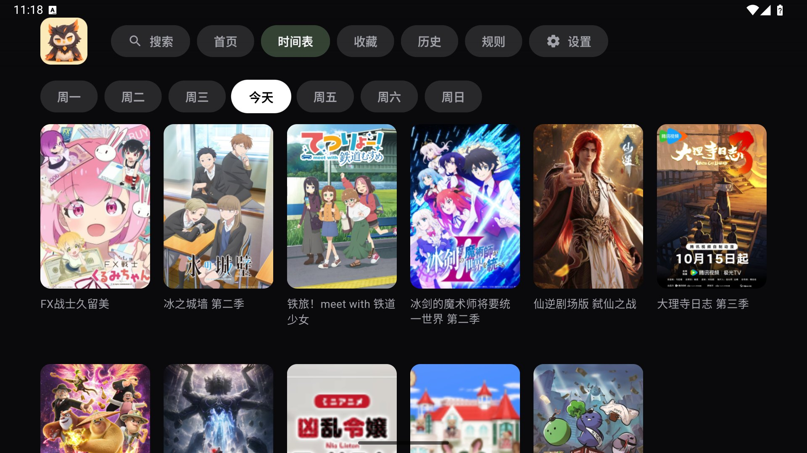
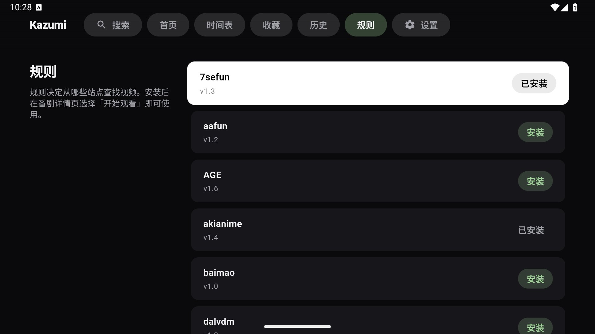
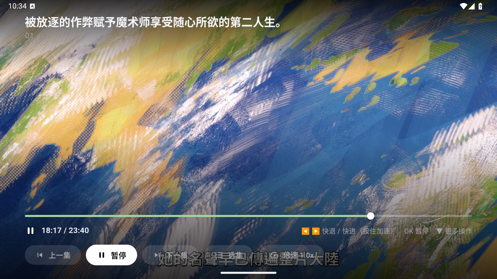
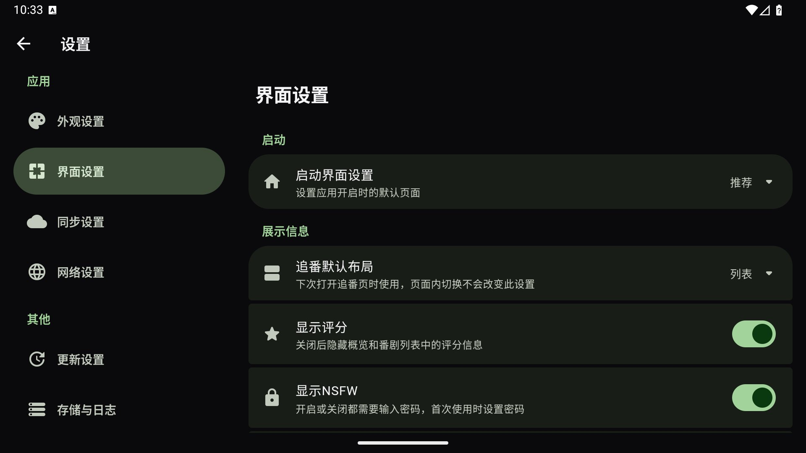
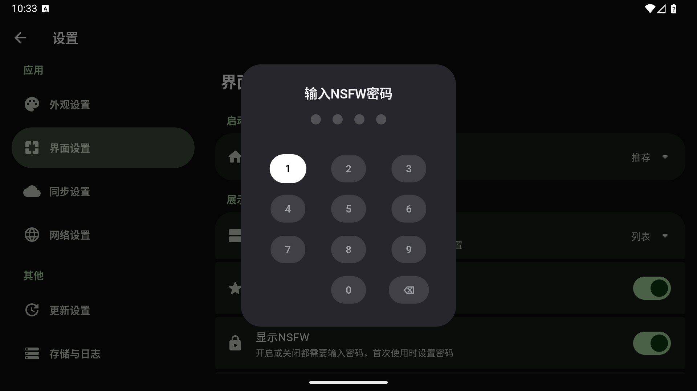

<div align=center>

<h1>Kurobi-TV</h1>

</img>

<p><b>Unofficial Android TV edition of <a href="https://github.com/Predidit/Kazumi">Kazumi</a></b></p>

<p>English | <a href="README.md">简体中文</a></p>

<p>Kurobi-TV is a fork of Kazumi with a UI and player redesigned for TVs and remotes (D-pad). Rules (XPath), video-source resolving, collections and history come from upstream.</p>
</div>

> This is **not** an official Kazumi release. Bugs in the TV UI belong in this repository, not upstream.

## Screen recording

https://github.com/user-attachments/assets/2ebf84c7-542c-491f-9321-fdaf5d7a0362

## Screenshots

<table>
  <tr>
    <td></td>
    <td></td>
  </tr>
  <tr>
    <td></td>
    <td></td>
  </tr>
  <tr>
    <td></td>
    <td></td>
  </tr>
  <tr>
    <td></td>
    <td></td>
  </tr>
  <tr>
    <td></td>
    <td></td>
  </tr>
</table>

The player shows remote hints at the bottom (rewind/forward, OK to pause, Down for more). The NSFW switch is in Settings, Interface. The first use asks you to set a 4-digit passcode, and switching it on or off always asks for it.

Screenshots are from a 1920x1080 Android TV emulator.

## What the TV edition adds

- **Remote-first UI.** Every screen works with D-pad, OK and Back only. Focus is always visible, and the navigation rail is on the left.
- **Home.** Categories, grid view, a Continue Watching row (items can be removed), and only whole poster cards in each row.
- **Browse.** Timeline, collections, history and rules pages.
- **Search.** By name or Bangumi tag, with sorting, a result count, and clearable search history.
- **Detail page.** Tags below the action buttons, a source picker, and episode choice before playback starts.
- **TV player.** D-pad scrubbing, pause on OK, and Back returns to the previous screen. Back on the home screen exits the app.
- **Parental lock.** A passcode-protected switch hides or shows 肉番 (NSFW) anime. The tag list is editable behind the passcode. It is a household lock, not strong security: a 4-digit code can be guessed.
- **Android TV integration.** Leanback launcher entry and TV banner.

## Inherited from Kazumi

XPath-based rules and rule import, multi-source playback, hardware decoding through media_kit, Bangumi metadata, collections and history.

## Known limits

- No danmaku on TV yet.
- **`KAZUMI_APPID` and `KAZUMI_KEY` are missing.** These keys belong to the upstream maintainer and are not shared, so they are empty in this project's builds. Without them, the signed Bangumi mirror endpoints (search, comments) fall back to the official Bangumi API, which can be slow or blocked on some networks. `DANDANAPI_APPID` and `DANDANAPI_KEY` (dandanplay) are missing too, so danmaku is unavailable.
- Android TV only. For phones, desktop and other platforms use [upstream Kazumi](https://github.com/Predidit/Kazumi).
- Tested on an Android TV emulator (1920x1080) and one Xiaomi TV (MiTV_MZTU0, Android 14, 32-bit ARM). Other devices are untested and may have problems.

## Install

1. Download the APK from [Releases](https://github.com/callmejm/Kurobi-TV/releases/latest).
2. Copy it to the TV (USB drive, `adb install`, or a file manager app).
3. Allow installs from unknown sources and open **Kurobi-TV** from the launcher.

```bash
adb connect <tv-ip>:5555
adb install Kurobi-TV.apk
```

First launch has no rules. Import rules from [KazumiRules](https://github.com/Predidit/KazumiRules) or the rules page.

## Build

```bash
flutter pub get
flutter run --dart-define=FORCE_TV=true   # force the TV UI on an emulator without the Leanback feature
flutter test
flutter analyze --no-fatal-infos --fatal-warnings
```

API keys are injected with `--dart-define=KAZUMI_APPID=... KAZUMI_KEY=...` (and `DANDANAPI_APPID`, `DANDANAPI_KEY`). They default to empty strings, so the app still builds and runs with the limits above.

TV code lives in `lib/tv/`. The phone UI in `lib/pages/` is unchanged. `TvEnvironment` picks the UI at startup.

## AI assistance

The TV code in this fork was written with AI assistance: **Claude Opus 5.5** (Anthropic), through Claude Code. The author reviewed and tested the changes.

## Credits and disclaimer

The app icon and the owl mascot belong to this project. Upstream Kazumi's icon, which is not free to reuse, is not used.

Built on [Kazumi](https://github.com/Predidit/Kazumi) by Predidit and its [contributors](https://github.com/Predidit/Kazumi/graphs/contributors). Upstream credits apply here too. Licensed under GPL-3.0 without any warranty. Follow your local laws and do not infringe third-party rights. Clear data and caches created by use within 24 hours unless you hold authorization from the rights holders. No user data is collected and no telemetry is used.
