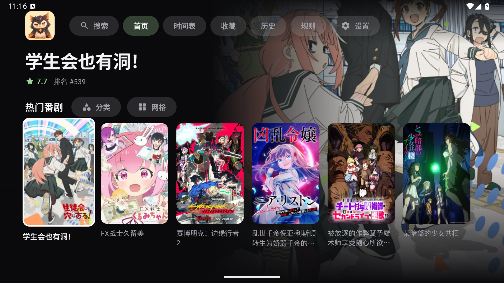
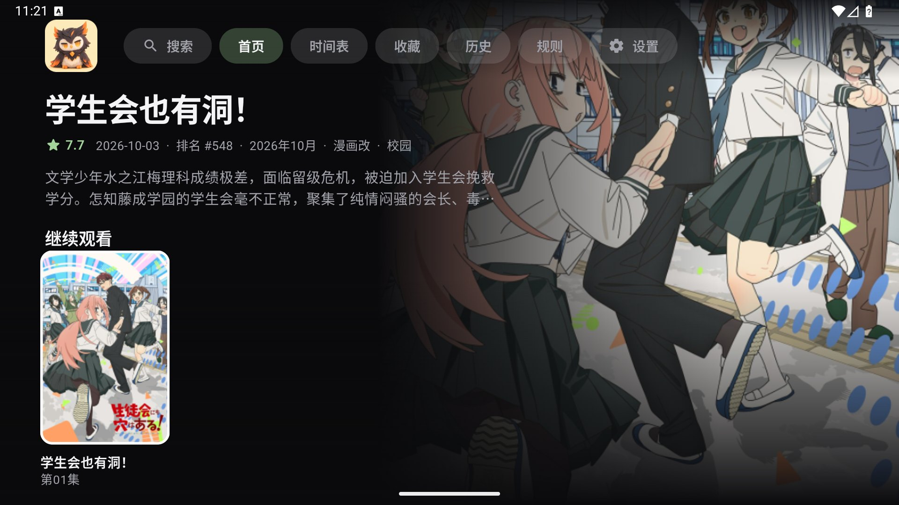
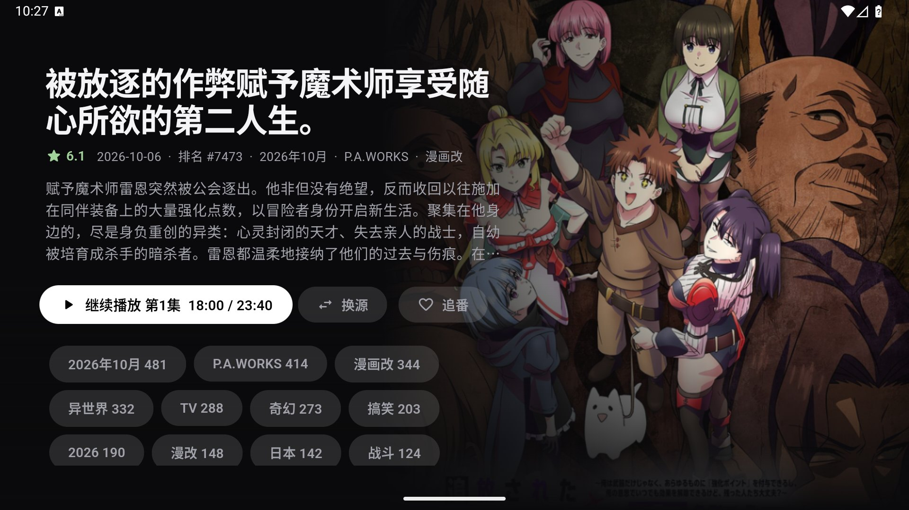
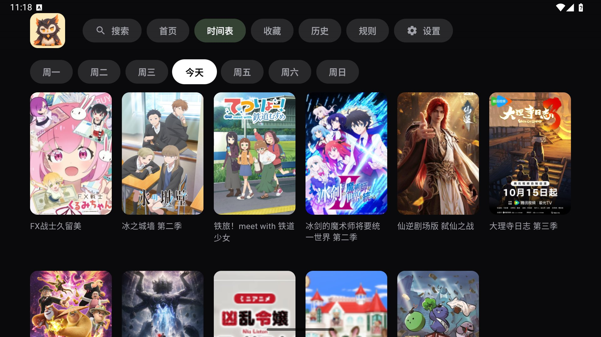
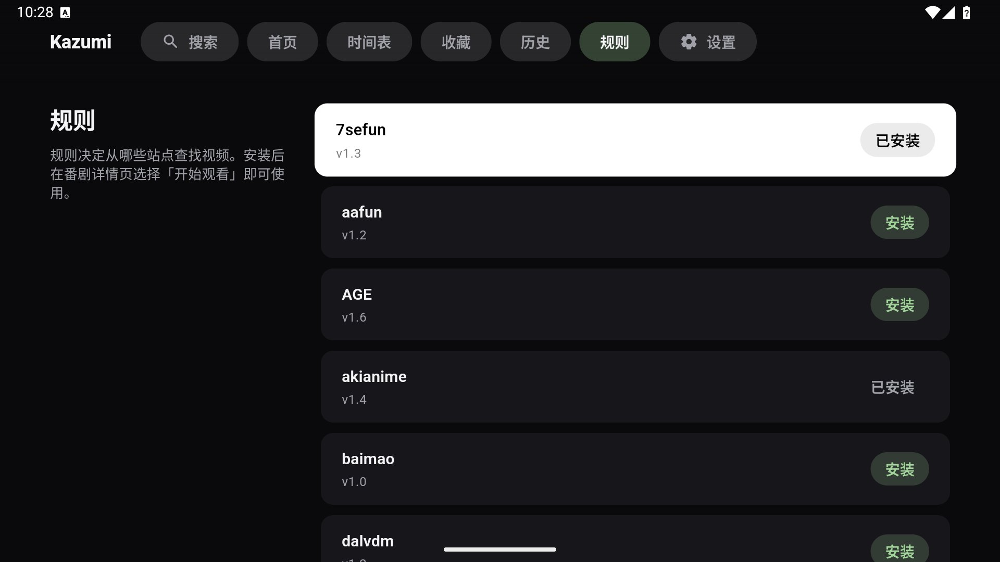
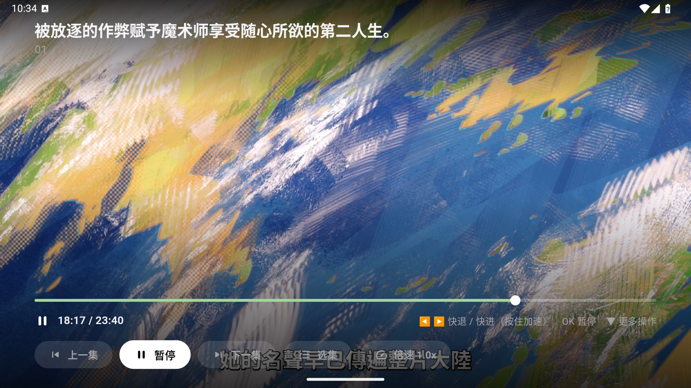
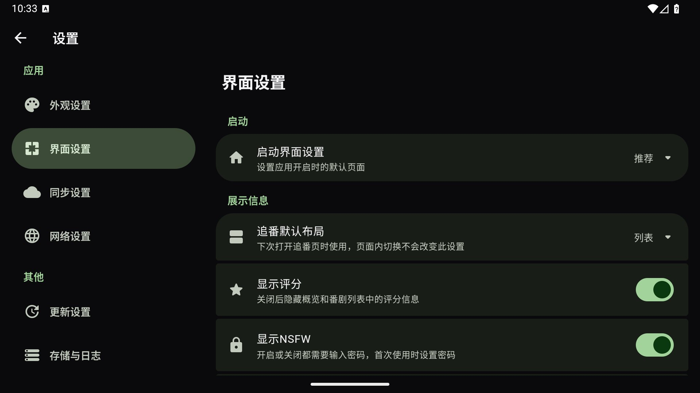
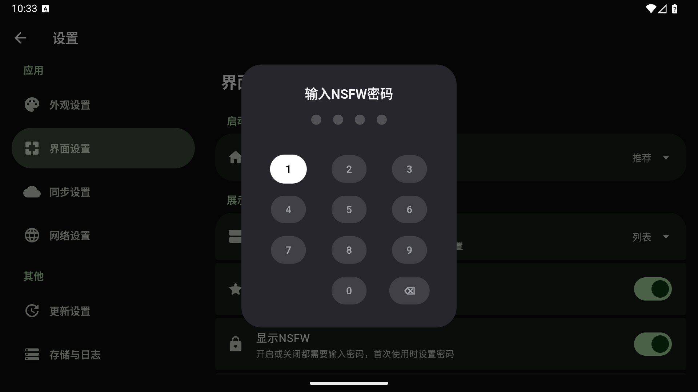

<div align=center>

<h1>Kazumi-TV</h1>

<p><b>非官方的 <a href="https://github.com/Predidit/Kazumi">Kazumi</a> Android TV 版本</b></p>

<p><a href="README.en.md">English</a> | 简体中文</p>

</img>
</img>
</img>

<p>Kazumi-TV 是基于 Kazumi 的分支, 为电视和遥控器 (D-pad) 重新设计了界面与播放器。规则 (Xpath)、视频源解析、追番、历史记录等核心能力沿用上游 Kazumi。</p>
</div>

> 这**不是** Kazumi 官方发布版本。电视端界面的问题请在本仓库反馈, 不要打扰上游。

## 屏幕录影

https://github.com/user-attachments/assets/41f03fb9-05ef-44e4-869a-760c35d71cef

## 屏幕截图

<table>
  <tr>
    <td></td>
    <td></td>
  </tr>
  <tr>
    <td></td>
    <td></td>
  </tr>
  <tr>
    <td></td>
    <td></td>
  </tr>
  <tr>
    <td></td>
    <td></td>
  </tr>
</table>

播放器底部会显示遥控器按键提示 (快退/快进、OK 暂停、下键更多操作)。NSFW 开关位于 设置, 界面设置, 首次使用时需要设置 4 位密码, 之后开启或关闭都要输入密码。

截图来自 1920x1080 的 Android TV 模拟器。

## TV 版新增功能

- **遥控器优先的界面**: 所有页面只用方向键、确认键和返回键即可操作, 焦点始终可见, 左侧为导航栏。
- **首页**: 分类浏览、网格视图、继续观看 (可移除条目); 每行只显示完整的海报卡片。
- **浏览**: 时间表、追番、历史记录、规则页面。
- **搜索**: 支持按名称或 Bangumi 标签搜索, 可排序, 显示结果数量, 可清除搜索历史。
- **详情页**: 操作按钮下方显示标签; 可选择视频源; 播放前先选择集数。
- **TV 播放器**: 方向键拖动进度条, 确认键暂停, 返回键回到上一页; 在首页按返回键会完全退出应用。
- **家长锁**: 用密码保护的开关来隐藏或显示 肉番 (NSFW) 内容, 标签列表可在密码后编辑。这只是家庭内的访问限制, 不是强安全措施: 4 位密码可以被猜到。
- **Android TV 集成**: 支持 Leanback 启动器入口和电视横幅图。

## 沿用上游的功能

基于 Xpath 的自定义规则与规则导入、多视频源播放、基于 media_kit 的硬件解码、Bangumi 番剧元数据、追番列表与历史记录。

## 当前限制

- TV 端暂不支持弹幕。播放器目前使用一个不绘制任何内容的弹幕控制器。
- **缺少 `KAZUMI_APPID` 和 `KAZUMI_KEY`。** 这两个密钥属于上游维护者, 不对外提供, 本项目的构建中为空。没有它们时, 需要签名的 Bangumi 镜像接口 (搜索、评论) 会改为直接请求官方 Bangumi API, 在部分网络环境下搜索可能较慢或不可用。`DANDANAPI_APPID` 和 `DANDANAPI_KEY` (弹弹play) 同样没有, 所以弹幕不可用。
- 仅面向 Android TV。手机、桌面等其他平台请使用 [上游 Kazumi](https://github.com/Predidit/Kazumi)。
- <!-- TODO: 补充已测试的设备与模拟器 -->

## 下载与安装

1. 从 [Releases](https://github.com/callmejm/Kazumi-TV/releases/latest) 下载 APK。<!-- TODO: 目前还没有发布版本 -->
2. 通过 U 盘、`adb install` 或文件管理器应用把 APK 放到电视上。
3. 允许安装未知来源应用, 然后在启动器中打开 **Kazumi-TV**。

```bash
adb connect <电视IP>:5555
adb install Kazumi-TV.apk
```

首次启动时没有任何规则。请从 [KazumiRules](https://github.com/Predidit/KazumiRules) 仓库或规则页面导入规则。

## 从源码构建

```bash
flutter pub get
flutter run --dart-define=FORCE_TV=true   # 在没有 Leanback 特性的模拟器上强制使用 TV 界面
flutter test
flutter analyze --no-fatal-infos --fatal-warnings
```

API 密钥通过 `--dart-define=KAZUMI_APPID=... KAZUMI_KEY=...` (以及 `DANDANAPI_APPID`、`DANDANAPI_KEY`) 注入, 不提供时默认为空字符串, 应用仍可构建和运行, 只是上述功能受限。

代码结构: TV 相关代码位于 `lib/tv/`, `lib/pages/` 下的手机界面保持不变。应用在启动时通过 `TvEnvironment` 选择使用 TV 界面还是手机界面。

## AI 辅助声明

本分支的 TV 端代码由作者借助 AI 辅助开发, 使用的模型为 **Claude Opus 5.5** (Anthropic), 通过 Claude Code 完成。作者已审阅并测试这些改动。

## 与上游同步

`main` 与 `Predidit/Kazumi` 的 `main` 保持一致, TV 相关改动定期合并在其之上。对所有平台都有益的改动应优先提交到上游。

## 致谢

Kazumi-TV 基于 Predidit 及其 [贡献者](https://github.com/Predidit/Kazumi/graphs/contributors) 开发的 [Kazumi](https://github.com/Predidit/Kazumi)。上游的致谢同样适用于本项目: XpathSelector、弹弹play、Bangumi、Anime4K、SyncPlay、trace.moe、media-kit、avbuild、hive。

Kazumi 的应用图标版权属于其原作者, 不可自由使用。<!-- TODO: 首次发布前请替换启动图标与电视横幅图, 或取得原作者授权 -->

## 免责声明

本项目基于 GNU 通用公共许可证第 3 版 (GPL-3.0) 授权。我们不对其适用性、可靠性或准确性作出任何明示或暗示的保证。在法律允许的最大范围内, 作者和贡献者不承担任何因使用本软件而产生的直接、间接、偶然、特殊或后果性的损害赔偿责任。

使用本项目需遵守所在地法律法规, 不得进行任何侵犯第三方知识产权的行为。因使用本项目而产生的数据和缓存应在 24 小时内清除, 超出 24 小时的使用需获得相关权利人的授权。

## 隐私政策

我们不收集任何用户数据, 不使用任何遥测组件。
